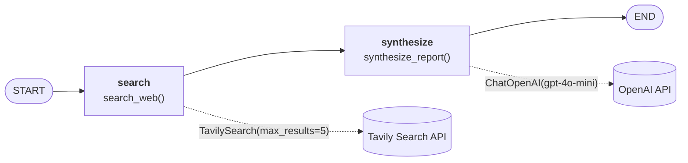
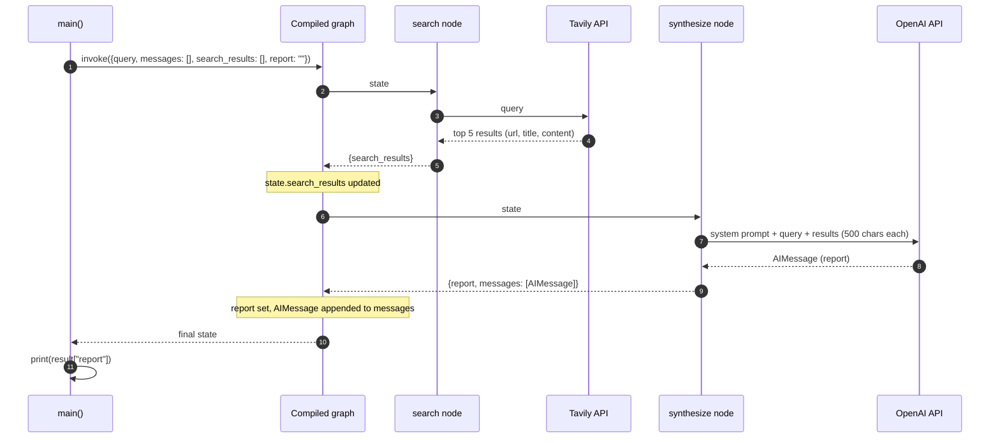

# Web Research Agent (LangGraph + Tavily)

A small LangGraph agent that searches the web for a topic with Tavily, then asks an OpenAI model to turn the results into a structured report (Summary, Key Findings, Sources).

## Architecture

### LangGraph workflow

`build_graph()` in [Agent.py](Agent.py) compiles a two-node `StateGraph`. Each node reads the shared `ResearchState` and returns only the keys it changes; LangGraph merges those updates into the state before running the next node.



### Shared state: `ResearchState`

| Key | Type | Written by | Merge behaviour |
|---|---|---|---|
| `query` | `str` | initial input | overwritten |
| `search_results` | `list[dict]` | `search` node | overwritten |
| `report` | `str` | `synthesize` node | overwritten |
| `messages` | `list` | `synthesize` node | appended (`add_messages` reducer) |

### How state flows through one run



## Setup

```powershell
python -m venv .venv
.\.venv\Scripts\Activate.ps1
pip install -r requirement.txt
```

Copy `.env.example` to `.env` and fill in your keys:

```
OPENAI_API_KEY=...
TAVILY_API_KEY=...
```

## Run

```powershell
python Agent.py --query "latest advances in quantum computing"
```
