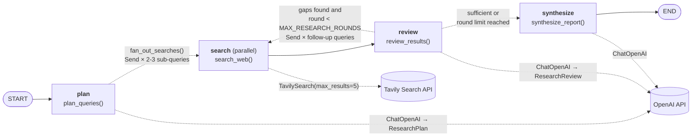
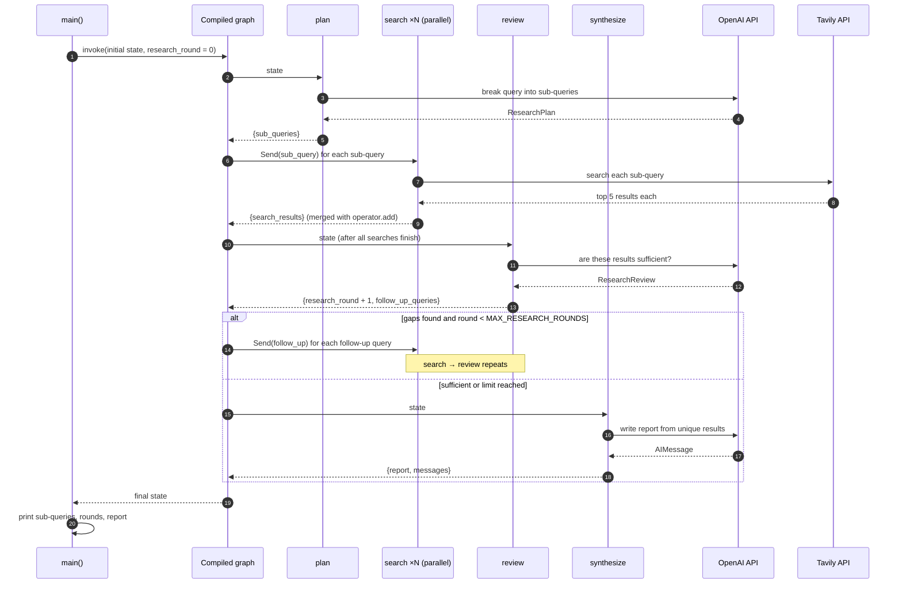

# Web Research Agent (LangGraph + Tavily)

A LangGraph agent that plans focused search queries for a topic, searches the web for them in parallel with Tavily, checks whether the findings are sufficient (looping back for follow-up searches if not), and then asks an OpenAI model to write a structured report (Summary, Key Findings, Sources).

## Architecture

### LangGraph workflow

`build_graph()` in [Agent.py](Agent.py) compiles a four-node `StateGraph`. Solid arrows are fixed edges; dotted arrows are conditional edges whose target is decided at runtime.



### LangGraph features used

| Feature | Where | What it does here |
|---|---|---|
| Structured output | `plan`, `review` | `with_structured_output()` makes the LLM return a `ResearchPlan` / `ResearchReview` Pydantic object instead of free text. |
| Fan-out with `Send` | `fan_out_searches()`, `route_after_review()` | Starts one `search` node per query; they run in parallel in the same step. |
| Reducers | `search_results`, `messages` | `operator.add` merges results from the parallel searches; `add_messages` appends chat messages. |
| Fan-in | `search → review` | `review` runs once, after every parallel `search` in that step has finished. |
| Conditional edge + cycle | `route_after_review()` | Loops back to `search` for follow-up queries, or moves on to `synthesize`. |
| Loop guard | `MAX_RESEARCH_ROUNDS = 2` | Caps the number of search → review rounds so the loop always ends. |

### Shared state: `ResearchState`

| Key | Type | Written by | Merge behaviour |
|---|---|---|---|
| `query` | `str` | initial input | overwritten |
| `sub_queries` | `list[str]` | `plan` | overwritten |
| `search_results` | `list[dict]` | `search` (each parallel run) | appended (`operator.add`) |
| `follow_up_queries` | `list[str]` | `review` | overwritten |
| `research_round` | `int` | `review` | overwritten (incremented) |
| `report` | `str` | `synthesize` | overwritten |
| `messages` | `list` | `synthesize` | appended (`add_messages`) |

The `search` node doesn't receive the whole state: each `Send` passes it a small `SearchTask` (`{"sub_query": ...}`). Search results are de-duplicated by URL (`unique_results()`) before `review` and `synthesize` use them.

### How state flows through one run



## Setup

```powershell
python -m venv .venv
.\.venv\Scripts\Activate.ps1
pip install -r requirement.txt
```

Copy `.env.example` to `.env` and fill in your keys:

```
OPENAI_API_KEY=...
TAVILY_API_KEY=...
```

## Run

```powershell
python Agent.py --query "latest advances in quantum computing"
```

Tune `MAX_RESEARCH_ROUNDS` in [Agent.py](Agent.py) to trade thoroughness for cost: each extra round adds up to 2 Tavily searches and one more OpenAI review call.
